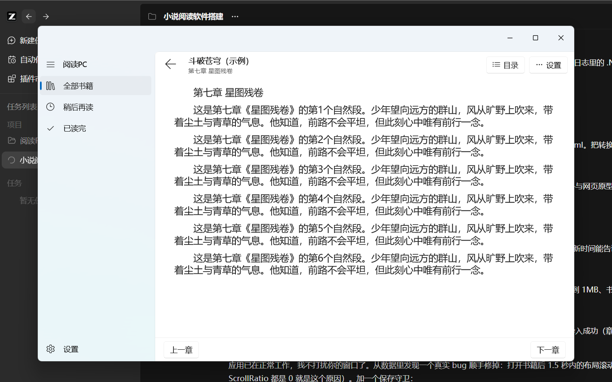
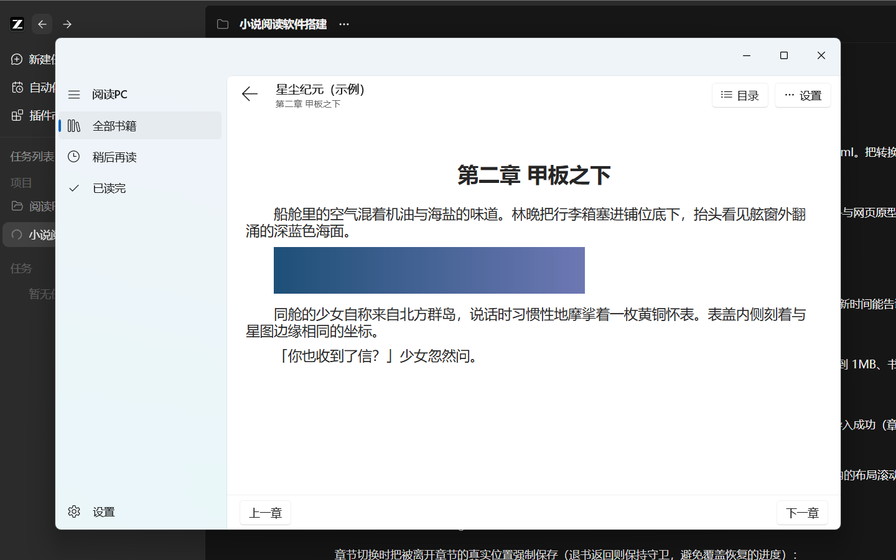

# 轻阅读 QingYueDu

**基于 WinUI 3 的现代化 Windows 桌面小说阅读器**

支持 TXT / EPUB · 上下滚动 / 双栏 / 仿真 / 覆盖四种翻页方式 · 划词批注 · 自动翻页 · 本地优先

---

## ✨ 功能特性

### 📖 多格式阅读
- **TXT**：自动编码检测（UTF-8 / GBK / GB18030 / Big5…）、智能章节切分（第 X 章 / 卷 / 楔子 / 番外…）
- **EPUB**：完整解析 OPF / spine，保留原书样式与图片，WebView2 高保真渲染
- 2348 章 / 22MB 的超大文件实测流畅

### 🎨 沉浸式阅读体验
- **四种翻页方式**：上下滚动 / 左右翻动 / 仿真翻页（3D 卷页）/ 覆盖翻页
- **双栏排版**：可与左右 / 仿真 / 覆盖模式自由组合
- **微信读书风设置面板**：背景色块、字体胶囊（按字体渲染预览）、A∓ 字号步进、行距 / 段距 / 字距档位
- **阅读主题**：白纸 / 羊皮纸 / 护眼绿 / 夜间，实时切换不丢位置
- **跨章连续滚动**：滚动到底自动加载下一章，1795 章大部头无卡顿

### 🔖 书签与批注
- 章节级书签，一键添加 / 移除 / 跳转
- **划词批注**：选中文字弹出浮层——四色高亮、笔记、复制；批注按字符偏移锚定，重启精确还原
- 批注列表面板统一管理

### 🗂 书库管理
- 单文件 / 文件夹批量导入
- 网格 / 列表双视图，搜索、排序
- 书籍详情页：元数据、完整目录跳转、继续阅读
- 进度实时持久化，重开自动定位

### 🔊 更多
- 自动翻页（可调速度浮层，滚动模式匀速滑读，分页模式定时翻页）
- TTS 听书、Legado 书源等规划中（见 [路线图](#-路线图)）

## 📸 截图

| 书架 | 阅读器 |
| --- | --- |
|  |  |

| EPUB | 排版自定义 |
| --- | --- |
|  |  |

## 📥 下载安装

前往 [**Releases**](../../releases) 页面下载 `QingYueDu-vX.X.X-win-x64.zip`，解压后运行 `QingYueDu.exe` 即可。

> 无需安装 .NET，压缩包已自包含全部运行时。
> 系统要求：Windows 10 (17763+) 或 Windows 11 x64；EPUB 渲染依赖 WebView2（Win11 自带）。

## 🧱 技术栈

| | |
| --- | --- |
| UI 框架 | WinUI 3 (Windows App SDK 1.6) · Fluent Design · Mica |
| 架构 | MVVM (CommunityToolkit.Mvvm) |
| TXT 解析 | Ude.NetStandard 编码探测 + 正则章节切分 |
| EPUB 解析 | 自研 ZipArchive + OPF 解析器（零第三方依赖） |
| 渲染 | WebView2 统一渲染管线（TXT / EPUB 共用） |
| 数据 | 本地 JSON（书库 / 进度 / 书签 / 批注 / 设置），不上传任何服务器 |
| 部署 | Unpackaged + 自包含运行时，解压即用 |

## 🗺 路线图

- [ ] TTS 听书（Windows 系统语音）
- [ ] 全文搜索
- [ ] Legado 书源（网文在线阅读）
- [ ] PDF 支持
- [ ] AI 助手（OpenAI / Claude / Gemini）

## 🤝 贡献

欢迎 Issue 与 PR！开发前请阅读构建说明；提交请附带复现步骤。

## 📄 许可证

[MIT](LICENSE) —— 数据完全存储在本地，不上传任何服务器。
