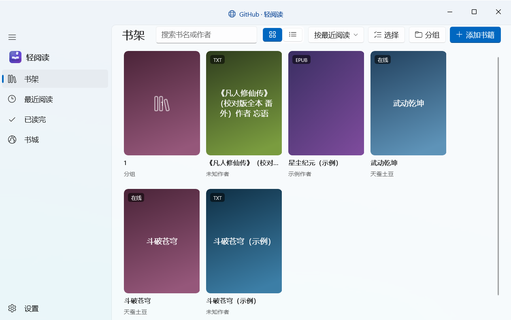
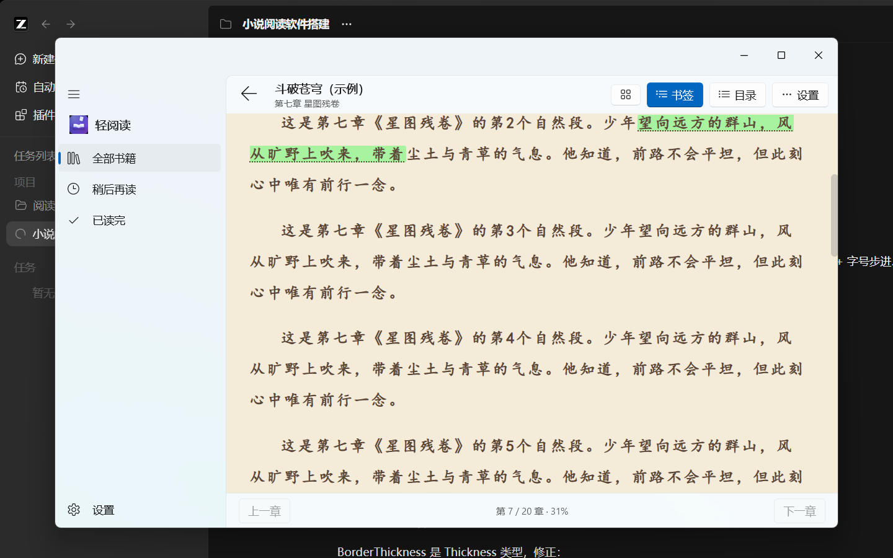
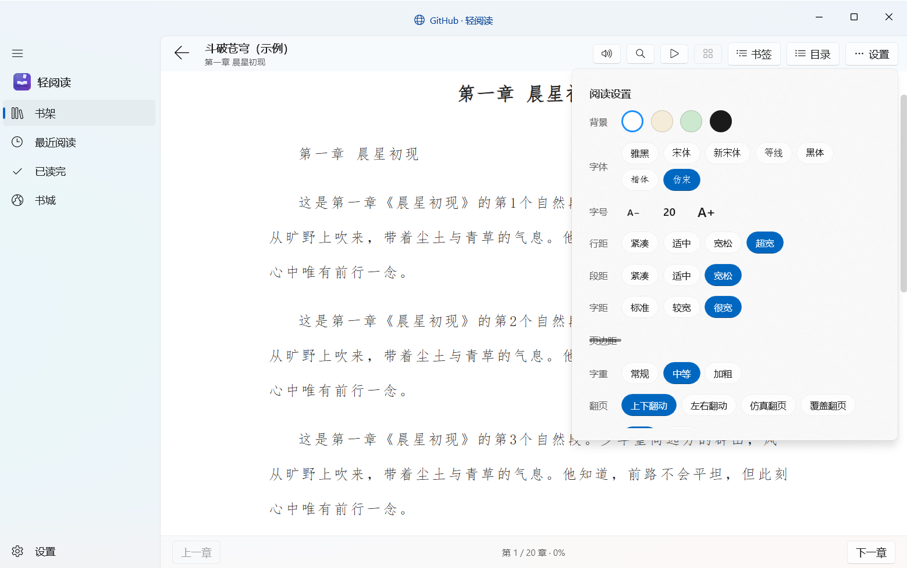
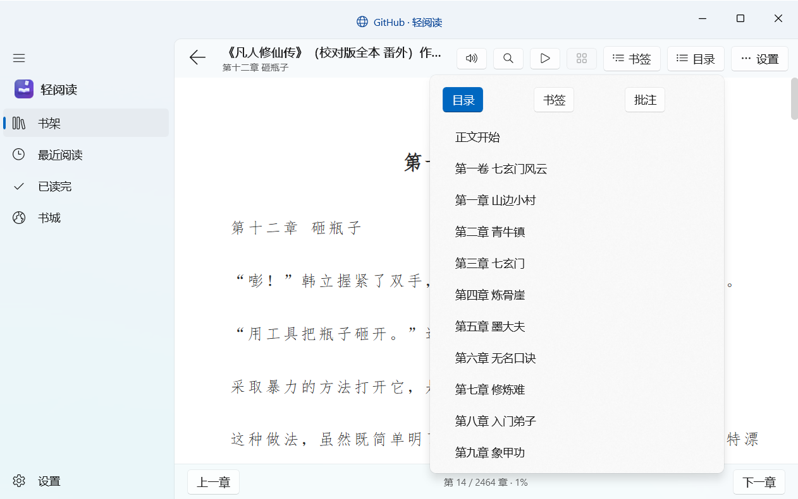
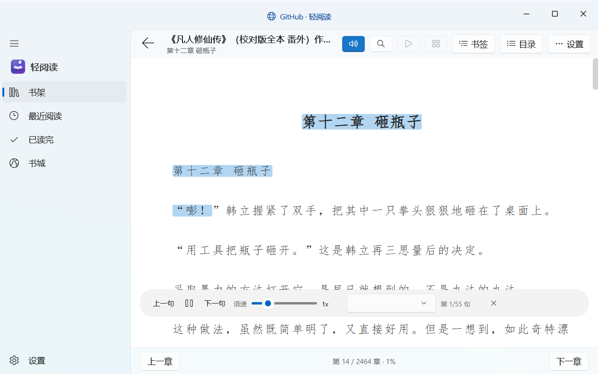
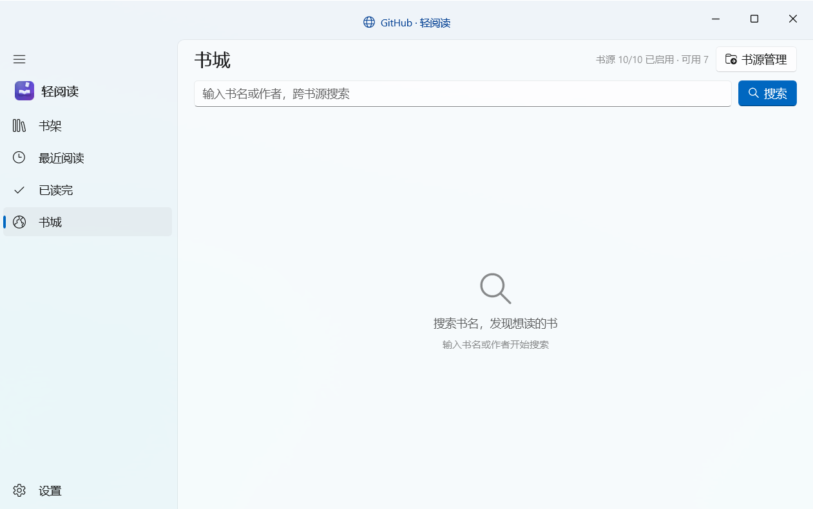
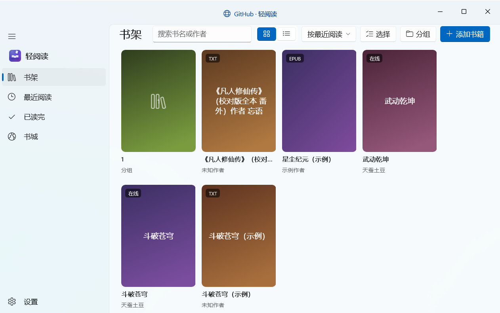

# 轻阅读 QingYueDu

**基于 WinUI 3 的现代化 Windows 桌面小说阅读器**

支持 TXT / EPUB / PDF / 漫画（CBZ·CBR·ZIP） · 四种翻页方式（默认左右翻页） · 划词批注 · 自动翻页 · TTS 多音色分角色朗读 · AI 问书 · 全文搜索 · Legado 书源 · 在线书自动缓存与追更 · 段评 · 微信读书风阅读统计 · 一键备份恢复 · 本地优先

**[🐙 GitHub](https://github.com/ligit520/QingYueDu)**

---

## ✨ 功能特性

### 📖 多格式阅读
- **TXT**：自动编码检测（UTF-8 / GBK / GB18030 / Big5…）、智能章节切分（第 X 章 / 卷 / 楔子 / 番外…）
- **EPUB**：完整解析 OPF / spine，保留原书样式与图片，WebView2 高保真渲染；支持文档模式（保留原始排版）
- **PDF**：内置 PDF.js 引擎（离线可用），连续滚动、适应宽度 / 页面 / 自定义缩放、目录 / 缩略图 / 批注侧边栏、文本标记（高亮 / 下划线 / 删除线）+ 图形标记（矩形 / 椭圆 / 箭头）+ 自由手绘 / 自由高亮、全文搜索与划词翻译，批注独立存储不改动原文件，支持按页导出 Markdown / JSON
- **漫画（CBZ / CBR / ZIP）**：独立阅读器，单页 / 双页 spread / 连续滚动三模式，图片缓存 + 预加载，缩放 50%~400%，双指缩放 / 方向锁定 / 翻页手势，页码进度持久化
- 万页级 PDF / 千章级网文实测流畅（虚拟滚动，只渲染可见部分）

### 🎨 沉浸式阅读体验
- **四种翻页方式**：上下滚动 / 左右翻动 / 仿真翻页（3D 卷页）/ 覆盖翻页
- **双栏排版**：可与左右 / 仿真 / 覆盖模式自由组合
- **微信读书风设置面板**：背景色块、字体胶囊（按字体渲染预览）、A∓ 字号步进、行距 / 段距 / 字距档位；支持自定义字体导入
- **阅读主题**：白纸 / 羊皮纸 / 护眼绿 / 夜间 + **自定义背景色 / 文字色**（取色器），实时切换不丢位置；另有亮度 / 色温调节、自动夜间主题、应用强调色自定义
- **排版偏好按本书记忆**：字号 / 字体 / 行距等按书保存，一键重置默认；宽窗口自动双栏
- **跨章连续滚动**：滚动到底自动加载下一章，1795 章大部头无卡顿
- **分页跨章续接**：左右翻动 / 仿真 / 覆盖模式翻到章尾时自动加载并接入下一章，无需手动点「下一章」

### 🔖 书签与批注
- 章节级书签，一键添加 / 移除 / 跳转（按钮高亮指示当前章状态）；读到 50% 自动生成位置快照书签
- **划词批注**：选中文字弹出浮层——四色高亮、下划线、删除线、笔记、复制、翻译、词典、浏览器搜索；批注按字符偏移锚定，重启精确还原
- 批注列表面板按章节分组，支持跳转 / 编辑 / 删除 / 搜索过滤，全书批注与书签可导出 Markdown / JSON
- 笔迹手写批注（PDF）；PDF 划词复制与按页导出批注

### 🗂 书库管理
- 单文件 / 文件夹批量导入
- 网格 / 列表双视图，搜索、排序
- **书架分组**：拖动封面到分组框即可归类（网格 / 列表均支持），支持批量选择与「最近阅读」「已读完」视图
- 书籍详情页：元数据、完整目录跳转、继续阅读
- 进度实时持久化，重开自动定位

### 🔊 听书与搜索
- **TTS 听书**：本地系统语音 + Edge 云端语音双引擎，按句朗读、朗读高亮、上一句 / 下一句跳转、语速 / 音量 / 定时关闭、**断点续读**
- **多音色分角色朗读**：自动识别章节对话角色，逐角色分配不同音色；「声部」面板检测角色、分配音色，按本书记忆
- **全文搜索**：跨全书章节搜索，区分大小写 / 全词 / 正则，关键词高亮定位，点击结果直达命中处；目录 / 批注面板支持搜索过滤

### 🌐 在线书源（Legado 规则引擎）
- **内置书源**：内置多条笔趣阁等常用书源，开箱即用
- **书源管理**：URL / 文件 / 剪贴板三种导入方式，列表化管理，一键启用 / 停用 / 删除，支持多选全开 / 全关
- **可用性检测**：启动时自动检测已启用书源，导入后即时检测，也可在书源管理页手动检测，结果一目了然
- **书城**：跨已启用书源搜索书籍，结果展示目录章节数，点击直接在线阅读；左侧数据源面板展示 Z-Library 支持详情
- **在线书本地化**：加入书架即缓存详情与目录，自动逐章抓取正文存本地（`chapters/`），阅读优先读缓存、支持断点续传；封面自动下载到 `covers/`
- **在线书闭环**：加入书架自动后台缓存全部章节（串行队列、进度可视）、启动自动检测更新并在书架横幅提醒、支持一键换源（换源后自动按新源重新缓存）
- **搜索优化**：多源合并搜索（去重 + 排序）、竞态隔离、失败源自动重试、目录分页完整抓取（数千章不漏）
- **书源可视化编辑**：原始 JSON 编辑 + 实时校验 + 格式化，规则字段概览；支持规则导入向导生成 Legado JSON
- **段评**：书源支持 `ruleComment` 时，侧边栏「段评」标签查看 / 回复段评，按章缓存

### 🤖 AI 助手（用户自配 API Key）
- 兼容 OpenAI / Claude / Gemini 等 Chat Completions 端点
- **全书总结 / 章节速读 / 多轮问答 / 本章续写 / 排版纠错 / 人物关系提取**
- 全书内容上下文 + 当前章节上下文，历史对话连续追问

### 🔄 数据同步与备份
- **本地增量同步**：进度 / 书签 / 批注导出与导入对账
- **每日自动备份**：本地目录备份，保留最近 N 份
- **Wi-Fi 传书**：同一局域网内浏览器传书到书架

### 📊 阅读统计（仿微信读书）
- **周 / 月 / 年 / 总 / 阅历** 五种口径，可左右翻看历史周期，自动计算日均与环比涨跌
- 阅读时长大数字卡 + 四宫格（读过 / 读完 / 阅读天数 / 笔记）
- **柱状图**：周 7 根（周一~周日）、月每自然日一根、年每月一根，柱顶显示时长，带纵轴刻度与虚线网格
- **阅读日历**：GitHub 风全年热力图，按阅读时长分五档着色
- **年度阅读报告**：亮点 + 时长榜 + 导出 Markdown；**阅读历程时间线**（最近 30 天）；**按小时段分布**（24h 柱状图 + 峰值时段）
- **每日目标打卡**：阅读目标设定与连续打卡
- 阅读时自动计时并落盘到 `stats.json`，统计页每分钟刷新

### 💾 数据备份与恢复
- **一键备份**：设置页选择目录，自动生成含全部数据的 zip（书籍 / 进度 / 书签批注 / 统计 / 书源 / 在线缓存 / 封面）
- **从备份恢复**：二次确认 + 备份校验，恢复前自动留一份安全网备份
- 也支持命令行：`--backup-to:目录`、`--validate-backup:zip`、`--restore-test:zip;目录`
- 数据全部本地 JSON，与程序目录分离，升级不丢失

### ⚙️ 设置
- **分类二级结构**：主页 9 个分类卡片（外观 / 阅读 / 书源与传书 / 缓存管理 / 智能服务 / 数据与备份 / 快捷键 / 关于 / 隐私），点击进入对应详情页，Esc / 返回按钮回主页；含隐私声明页
- **主题模式**：跟随系统 / 浅色 / 深色 + 按时段自动夜间 + 自定义强调色
- **默认阅读模式**：支持上下滚动 / 左右翻页 / 双栏翻页，默认左右翻页，可在阅读器内随时切换四种翻页方式；翻页动画 / 点击翻页可开关
- **其他**：存储位置更改、开机自启、文件夹监控导入、系统托盘、快捷键自定义、GitHub 更新检查、首次配置向导

## 📸 截图

| 书架 | 阅读器 |
| --- | --- |
|  |  |

| 排版自定义 | 全文搜索 |
| --- | --- |
|  |  |

| 目录面板 | TTS 听书 |
| --- | --- |
|  |  |

| 书城 | 书源管理 |
| --- | --- |
|  |  |

| 设置 |
| --- |
|  |

## 📥 下载安装

前往 [**Releases**](https://github.com/ligit520/QingYueDu/releases) 页面下载 `QingYueDu-vX.X.X-win-x64.zip`，解压后运行 `QingYueDu.exe` 即可。

> 无需安装 .NET，压缩包已自包含全部运行时。
> 系统要求：Windows 10 (17763+) 或 Windows 11 x64；EPUB 渲染依赖 WebView2（Win11 自带）。

## 🧱 技术栈

| | |
| --- | --- |
| UI 框架 | WinUI 3 (Windows App SDK 1.8) · Fluent Design · Mica |
| 架构 | MVVM (CommunityToolkit.Mvvm) |
| TXT 解析 | Ude.NetStandard 编码探测 + 正则章节切分 |
| EPUB 解析 | 自研 ZipArchive + OPF 解析器（零第三方依赖） |
| 渲染 | WebView2 统一渲染管线（TXT / EPUB 共用）+ PDF.js（PDF 按页渲染） |
| 书源引擎 | 自研 Legado 规则引擎（CSS 选择器 / XPath 子集） |
| 数据 | 本地 JSON（书库 / 进度 / 书签 / 批注 / 统计 / 设置）+ 章节缓存，不上传任何服务器 |
| 部署 | Unpackaged + 自包含运行时，解压即用 |

## 🗺 路线图

- [x] PDF 支持（见「多格式阅读」）
- [x] AI 助手（OpenAI / Claude / Gemini，见「AI 助手」）
- [x] 漫画阅读、TTS 多音色分角色、段评、自定义配色、每日自动备份
- 当前版本 **v0.5.0**，完整变更见 [CHANGELOG.md](CHANGELOG.md)

## 🤝 贡献

欢迎 Issue 与 PR！开发前请阅读构建说明；提交请附带复现步骤。

## 📄 许可证

[MIT](LICENSE) —— 数据完全存储在本地，不上传任何服务器。
